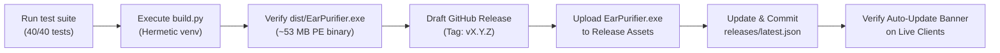

# Operations & Maintenance Manual

*Verified against codebase (v0.0.1).*

---

## Document Scope

- **In scope**:
  - Operational lifecycle and maintenance of the EarPurifier desktop application.
  - Compilation and packaging procedures for portable standalone binaries (`dist/EarPurifier.exe`).
  - Publishing workflows: GitHub Releases, version tagging, bilingual manifest updating (`releases/latest.json`), and auto-update verification.
  - Remote cloud cache maintenance: building and updating `earpurifier-cloud-assets-v2` on Kaggle.
  - Credential provisioning, DPAPI key storage, and emergency revocation procedures.
  - Storage hygiene, diagnostic log inspection (`applogs/`, `kaggle_logs/`), and state recovery procedures.
  - Ranked Dangerous Operations table cataloging destructive administrative actions.
- **Out of scope**:
  - Deep system architecture and component designs (governed by [`TECHNICAL.md`](TECHNICAL.md)).
  - Mandatory coding rules, concurrency contracts, and coding invariants (governed by [`BINDING_RULES.md`](BINDING_RULES.md)).
  - End-user installation overviews and feature marketing (governed by [`README.md`](../README.md)).

---

## Governance & Update Policy

- **Update Triggers**: Any change to build tooling (`build.py`), GitHub release workflows, Kaggle dataset cache update processes, manifest schema (`releases/latest.json`), or storage cleanup logic requires an immediate, mandatory update to this document.
- **Exclusion Policy**: Internal class refactoring, UI style tweaks, or algorithm optimizations must NOT be documented here unless they alter an operational procedure or maintenance command.

---

## Table of Contents

1. [Service Lifecycle & Runtime Environment](#1-service-lifecycle--runtime-environment)
   - 1.1. [Runtime Filesystem Layout](#11-runtime-filesystem-layout)
   - 1.2. [Application Boot & Single-Instance IPC](#12-application-boot--single-instance-ipc)
   - 1.3. [Graceful Teardown Sequence](#13-graceful-teardown-sequence)
2. [Release & Publishing Playbook](#2-release--publishing-playbook)
   - 2.1. [Step 1: Hermetic Local Build via `build.py`](#21-step-1-hermetic-local-build-via-buildpy)
   - 2.2. [Step 2: Binary Verification & Test Suite Execution](#22-step-2-binary-verification--test-suite-execution)
   - 2.3. [Step 3: GitHub Release Tagging & Asset Upload](#23-step-3-github-release-tagging--asset-upload)
   - 2.4. [Step 4: Updating `releases/latest.json` Manifest](#24-step-4-updating-releaseslatestjson-manifest)
   - 2.5. [Step 5: Verifying Auto-Update Delivery](#25-step-5-verifying-auto-update-delivery)
3. [Kaggle Master Cache Maintenance](#3-kaggle-master-cache-maintenance)
   - 3.1. [Cache Rebuild Triggers & Architecture](#31-cache-rebuild-triggers--architecture)
   - 3.2. [Rebuild Execution via `build_master_cache.py`](#32-rebuild-execution-via-build_master_cachepy)
   - 3.3. [Dataset Permissions & Verification](#33-dataset-permissions--verification)
4. [Credential & Key Operations](#4-credential--key-operations)
   - 4.1. [Generating Kaggle `KGAT_` Personal Access Tokens](#41-generating-kaggle-kgat_-personal-access-tokens)
   - 4.2. [DPAPI Storage & Configuration Insertion](#42-dpapi-storage--configuration-insertion)
   - 4.3. [Emergency Token Revocation & Hot-Swapping](#43-emergency-token-revocation--hot-swapping)
5. [Storage Hygiene & Incident Diagnostics](#5-storage-hygiene--incident-diagnostics)
   - 5.1. [Application Logs & Kaggle Execution Mirroring](#51-application-logs--kaggle-execution-mirroring)
   - 5.2. [Orphan Buffer & Temp Cleanup](#52-orphan-buffer--temp-cleanup)
   - 5.3. [Recovering Corrupted State (`job_state.json`)](#53-recovering-corrupted-state-job_statejson)
6. [Ranked Dangerous Operations Table](#6-ranked-dangerous-operations-table)

---

## 1. Service Lifecycle & Runtime Environment

### 1.1. Runtime Filesystem Layout
EarPurifier stores all mutable state, user configurations, caches, logs, and external binary runtimes within the Windows roaming application data directory: `%APPDATA%\EarPurifier\` (e.g., `C:\Users\<Username>\AppData\Roaming\EarPurifier\`).

```
%APPDATA%\EarPurifier\
├── config.json               # User preferences & DPAPI-encrypted secrets
├── job_state.json            # Queue persistence & historical execution log
├── bin\                      # Standalone external binaries
│   ├── ffmpeg.exe            # Auto-downloaded or verified FFmpeg binary
│   ├── ffprobe.exe           # Auto-downloaded or verified FFprobe binary
│   └── micromamba.exe        # Package manager for local isolation
├── env\                      # Dedicated Python 3.11 environment (Local Engine)
│   ├── python.exe
│   ├── Lib\site-packages\    # PyTorch, CUDA, and audio-separator libraries
│   └── Scripts\
│       └── audio-separator.exe
├── temp\                     # Ephemeral extraction & alignment buffers
│   └── <job_id>\             # Stamped FLAC, WAV, and remuxed working files
├── empty_buffer\             # Staging directory for Kaggle dataset creation
└── applogs\                  # Diagnostic logging directory
    ├── earpurifier.log       # Current session rotating log (max 10 MB)
    ├── earpurifier.log.1..3  # Capped backups (maximum 3 backups = 40 MB max)
    └── kaggle_logs\          # Captured stdout/stderr from remote Kaggle kernels
        └── <job_id>.log      # Dedicated execution log per remote cloud job
```

### 1.2. Application Boot & Single-Instance IPC
1. **OS Shell Binding**: Calls `SetCurrentProcessExplicitAppUserModelID("EarPurifier.SproutAudio.Studio.2.0")` and initializes Per-Monitor DPI Awareness v2 (`SetProcessDpiAwareness(2)`).
2. **IPC Mutual Exclusion**:
   - The primary application instance binds a local named socket server: `EarPurifier_SingleInstance_IPC` via `QLocalServer`.
   - Secondary processes attempting to launch connect via `QLocalSocket`, transmit `b"ACTIVATE\n"`, flush with a 500 ms timeout, and terminate immediately with `os._exit(0)`.
   - The running instance receives the signal, calling `window.showNormal()`, `window.raise_()`, and `window.activateWindow()` to bring the window into focus without spawning duplicate processes.
3. **Automated Maintenance on Boot**:
   - `QueueManager._load_state()` resets any jobs left in non-terminal states (`PENDING`, `EXTRACTING`, `UPLOADING`, `PROCESSING_CLOUD`, `DOWNLOADING`, `REMUXING`, `PROCESSING_LOCAL`) to `status: "ERROR"` with message `"Interrupted by application shutdown."`.
   - Purges orphaned temporary folders: `%APPDATA%\EarPurifier\temp\` and `%APPDATA%\EarPurifier\empty_buffer\` via `shutil.rmtree()`.
   - `logger_setup.setup_logger()` evicts any log file older than 48 hours (172,800 seconds).

### 1.3. Graceful Teardown Sequence
When the user closes the main window (`closeEvent` in `ui/main_window.py`):
1. **Active Job Interception**: If jobs are actively processing, displays modal `CloseActiveJobDialog`. If the user rejects, close is aborted (`event.ignore()`).
2. **Queue State Abort**: Marks all active job IDs as `ABORTED` in `QueueManager`.
3. **Background Checker Stoppage**: Invokes `update_checker.stop_all_active_checkers()`.
4. **Worker Thread Join & Terminate**: Calls `process_tracker.terminate_qt_threads()` across active QThreads (`cloud_thread`, `local_thread`, etc.). Threads are given 500 ms to stop gracefully before `th.terminate()` and a 100 ms wait are invoked.
5. **Subprocess Tree Destruction**: Calls `process_tracker.cleanup_all_subprocesses()` executing `taskkill /F /T /PID <pid>` on all registered subprocesses.
6. **Main Exit**: Releases IPC socket and exits cleanly via `os._exit(exit_code)`.

---

## 2. Release & Publishing Playbook

This playbook details the step-by-step procedure for producing, certifying, and publishing an official EarPurifier release.



---

### 2.1. Step 1: Hermetic Local Build via `build.py`
The build system uses `build.py` to create a dedicated, clean virtual environment with zero external package contamination.

1. Ensure the repository working tree is clean and aligned with `origin/main`.
2. Open PowerShell in the project root:
   ```powershell
   python build.py
   ```
3. **Automated Pipeline Execution**:
   - `build.py` creates an isolated virtual environment at `./venv/` with `system_site_packages=False`.
   - Installs strictly the minimal requirements from `requirements.txt`.
   - Kills any active `EarPurifier.exe` process holding file locks.
   - Executes PyInstaller with flags: `--name EarPurifier`, `--windowed`, `--onefile`, `--clean`, `--icon assets/logo.ico`, bundle mappings for `assets/` and `worker/`, and hidden imports (`PySide6`, `loguru`, `ui`, `i18n`, `update_checker`, `process_tracker`, `packaging`, `text_unidecode`).
   - Automatically deletes intermediate `./build/` and `./EarPurifier.spec`.

---

### 2.2. Step 2: Binary Verification & Test Suite Execution
Before distribution, execute all automated unit tests and verify the executable:

1. **Run Full Verification Suite**:
   ```powershell
   venv\Scripts\python.exe -m unittest tests/test_ui_overhaul.py
   venv\Scripts\python.exe -m unittest tests/test_studio_parity.py
   venv\Scripts\python.exe -m unittest tests/test_update_checker.py
   venv\Scripts\python.exe -m unittest tests/test_shutdown.py
   ```
   *Requirement*: All 40 tests must pass with 0 errors and 0 failures.

2. **Inspect Binary Artifact**:
   - Verify that `dist\EarPurifier.exe` exists.
   - Verify file size: approximately **53 MB to 56 MB** (if size exceeds 70 MB, an unwanted dependency was leaked into the environment).
   - Launch `dist\EarPurifier.exe` and confirm that the UI starts with the emerald theme, single-instance lock functions, and version pill displays `v0.0.1`.

---

### 2.3. Step 3: GitHub Release Tagging & Asset Upload
1. Create a Git tag corresponding to the release SemVer:
   ```powershell
   git tag -a v0.0.1 -m "Release v0.0.1: AI Audio Isolation Studio"
   git push origin v0.0.1
   ```
2. Navigate to GitHub Releases: `https://github.com/nitpacker/EarPurifier/releases/new`.
3. Select tag `v0.0.1`.
4. Release Title: `EarPurifier v0.0.1`.
5. Upload the compiled executable: attach `dist/EarPurifier.exe`.
6. Include release notes with bilingual comment tags or Markdown headers for the automatic changelog parser:
   ```markdown
   <!-- ar -->
   🎉 الإصدار الرسمي v0.0.1 من استوديو EarPurifier:
   • عزل وتنقية الصوت البشري بالذكاء الاصطناعي بدقة فائقة.
   • معالجة سحابية فائقة السرعة على خوادم Kaggle T4 مع معالجة محلية كاملة.
   • واجهة استوديو عصرية تدعم الوضعين الفاتح والداكن واللغة العربية بالكامل.
   <!-- /ar -->
   <!-- en -->
   🎉 Official Release v0.0.1 of EarPurifier Studio:
   • High-fidelity AI vocal isolation and audio purification.
   • High-speed cloud processing on Kaggle T4 GPUs plus full offline local engine.
   • Modern studio interface with full Light/Dark themes and bilingual localization.
   <!-- /en -->
   ```
7. Publish the release.

---

### 2.4. Step 4: Updating `releases/latest.json` Manifest
The update checker queries the raw repository manifest `https://raw.githubusercontent.com/nitpacker/EarPurifier/main/releases/latest.json` to bypass GitHub API rate limits.

Update `releases/latest.json` on the `main` branch with the exact release metadata:
```json
{
  "version": "0.0.1",
  "release_date": "2026-10-31",
  "download_urls": {
    "windows": "https://github.com/nitpacker/EarPurifier/releases/download/v0.0.1/EarPurifier.exe",
    "macos": "https://github.com/nitpacker/EarPurifier/releases/download/v0.0.1/EarPurifier_mac.dmg",
    "linux": "https://github.com/nitpacker/EarPurifier/releases/download/v0.0.1/EarPurifier.AppImage"
  },
  "download_url": "https://github.com/nitpacker/EarPurifier/releases/download/v0.0.1/EarPurifier.exe",
  "html_url": "https://github.com/nitpacker/EarPurifier/releases/tag/v0.0.1",
  "message": {
    "ar": "🎉 إصدار جديد من EarPurifier:\n• عزل وتنقية الصوت البشري بالذكاء الاصطناعي بدقة فائقة.\n• معالجة سحابية فائقة السرعة على خوادم Kaggle T4.\n• واجهة استوديو عصرية تدعم الوضعين الفاتح والداكن بالكامل.",
    "en": "🎉 New Release of EarPurifier:\n• High-fidelity AI vocal isolation and audio purification.\n• High-speed cloud processing on Kaggle T4 GPUs.\n• Modern studio interface with full Light/Dark themes."
  }
}
```

Commit and push directly to `origin/main`:
```powershell
git add releases/latest.json
git commit -m "chore(release): update latest.json manifest to v0.0.1"
git push origin main
```

---

### 2.5. Step 5: Verifying Auto-Update Delivery
1. Launch an existing installation of EarPurifier with a lower SemVer (e.g., simulating `0.0.0` or forcing an update check via Settings Dialog -> "Check Now").
2. Confirm that `UpdateBannerWidget` appears atop the workspace canvas.
3. Verify that the changelog displays correctly formatted Arabic text when language is `"ar"` and English when language is `"en"`.
4. Click "Download Update" and verify that the browser directs to the `EarPurifier.exe` download asset URL.

---

## 3. Kaggle Master Cache Maintenance

### 3.1. Cache Rebuild Triggers & Architecture
Cloud processing achieves ~2-second container setup by mounting pre-built wheels and model weights hosted in the public Kaggle dataset `verymuch/earpurifier-cloud-assets-v2`.

**Triggers That Require Rebuilding the Master Cache**:
1. **Kaggle Python Runtime Upgrade**: When Kaggle updates its base container Python version (e.g., Python 3.12 $\to$ 3.13), existing wheels become ABI-incompatible (`cp312` vs `cp313`).
2. **Upstream ML Package Updates**: Upgrading `audio-separator`, `torch`, or `onnxruntime-gpu`.
3. **Model Weight Changes**: Adding or updating separation models (e.g., new RoFormer or Demucs checkpoints).

### 3.2. Rebuild Execution via `build_master_cache.py`
The rebuild process is orchestrated locally by `docs/archive/build_master_cache.py` and executed remotely on Kaggle via `master_builder/builder.py`.

#### Requirements:
- Valid Kaggle credentials configured in `.env` or system environment (`KAGGLE_USERNAME`, `KAGGLE_KEY` or `KAGGLE_API_TOKEN`).
- Kaggle account with GPU quota available.

#### Execution Steps:
1. Run the coordinator script from the repository root:
   ```powershell
   python docs/archive/build_master_cache.py
   ```
2. **What the Process Executes**:
   - `docs/archive/build_master_cache.py` prepares the `master_builder/` directory with `kernel-metadata.json` and `builder.py`.
   - Pushes kernel `verymuch/earpurifier-cache-builder` to Kaggle via `kaggle.api.kernels_push()`.
   - Remote Kaggle GPU launches `master_builder/builder.py`.
   - Remote worker builds offline wheels (`pip wheel audio-separator[gpu] "onnxruntime-gpu<1.27.0"` into `wheels/`).
   - Downloads model weights (`Kim_Vocal_2.onnx`, `MDX23C-8KFFT-InstVoc_HQ.ckpt`, `model_bs_roformer_ep_317_sdr_12.9755.ckpt` into `models/`).
   - Remote worker pushes the newly built artifacts as a new version of dataset `verymuch/earpurifier-cloud-assets-v2`.
   - Coordinator polls kernel execution status until complete.

### 3.3. Dataset Permissions & Verification
1. Log in to `https://www.kaggle.com/datasets/verymuch/earpurifier-cloud-assets-v2`.
2. Ensure the dataset sharing settings are set to **Public**. If set to Private, remote user worker kernels will fail to mount the dataset.
3. Verify that the dataset contains:
   - `wheels/`: `.whl` files compatible with Kaggle's current CPython ABI.
   - `models/`: All three model checkpoint files.

---

## 4. Credential & Key Operations

### 4.1. Generating Kaggle `KGAT_` Personal Access Tokens
1. Log in to [Kaggle](https://www.kaggle.com/).
2. Navigate to **Account Settings** $\to$ **API**.
3. Click **Create New Token**.
4. Modern tokens are prefixed with `KGAT_` (e.g., `KGAT_abc123...`). Legacy tokens were 32-character hexadecimal strings. EarPurifier supports both formats.

### 4.2. DPAPI Storage & Configuration Insertion
- In the desktop application, open **Settings** (gear icon in the navigation rail).
- Enter **Kaggle Username** and paste the **Kaggle API Key** (`KGAT_...`).
- Click **Save Settings**:
  - `ConfigManager.save_config()` encrypts the key using Windows DPAPI (`CryptProtectData`).
  - Stored inside `%APPDATA%\EarPurifier\config.json` under `"kaggle_api_key"` with the prefix `enc:`.
  - The plaintext key is scrubbed from memory.

### 4.3. Emergency Token Revocation & Hot-Swapping
If a Kaggle token is compromised:
1. Immediately visit [Kaggle Settings](https://www.kaggle.com/) and click **Expire API Token**.
2. Open EarPurifier, open **Settings**, and paste the newly generated `KGAT_` token.
3. Save settings. `kaggle_bridge.py` automatically purges stale environment variables (`os.environ.pop("KAGGLE_KEY")`, `os.environ.pop("KAGGLE_API_TOKEN")`) upon the next job submission, preventing credential caching.

---

## 5. Storage Hygiene & Incident Diagnostics

### 5.1. Application Logs & Kaggle Execution Mirroring
When investigating customer issues or processing errors:
1. Open the log directory: `%APPDATA%\EarPurifier\applogs\`.
2. Inspect `earpurifier.log`:
   - Contains startup checks, DPAPI status, FFmpeg probing outputs, and local CLI stdout parsing.
   - Automatically rotated at 10 MB with 3 backups (`earpurifier.log.1`, `.2`, `.3`).
3. Inspect Cloud Job Logs: `%APPDATA%\EarPurifier\applogs\kaggle_logs\<job_id>.log`:
   - Upon completion or failure of a cloud job, `processor_thread.py` fetches the remote Kaggle kernel stdout/stderr and writes it to a dedicated file named after the job ID.
   - Look for `GPU FAILURE` or `ONNXRuntime` provider loading issues in this log.

### 5.2. Orphan Buffer & Temp Cleanup
If an abnormal termination (power cut, forced Windows reboot) leaves multi-gigabyte audio files on disk:
- EarPurifier automatically clears `%APPDATA%\EarPurifier\temp\` on every startup.
- **Manual Clean Command**:
  ```powershell
  Remove-Item -Recurse -Force "$env:APPDATA\EarPurifier\temp\*"
  Remove-Item -Recurse -Force "$env:APPDATA\EarPurifier\empty_buffer\*"
  ```

### 5.3. Recovering Corrupted State (`job_state.json`)
If `%APPDATA%\EarPurifier\job_state.json` is corrupted due to an external file system error:
1. Terminate all instances of `EarPurifier.exe`.
2. Delete or reset the state file:
   ```powershell
   Remove-Item "$env:APPDATA\EarPurifier\job_state.json"
   ```
3. Restart EarPurifier. `QueueManager` will automatically initialize a fresh, valid state file: `{"jobs": {}}`.

---

## 6. Ranked Dangerous Operations Table

The following operations carry significant risk to data integrity, quota consumption, or client stability:

| Rank | Operation | Hazard / Impact | Safe Mitigation Protocol |
| :---: | :--- | :--- | :--- |
| **1** | **Setting Kaggle Dataset `earpurifier-cloud-assets-v2` to Private** | Immediately breaks cloud separation for **all** client installations worldwide with permission errors. | Keep dataset strictly **Public** on Kaggle at all times. |
| **2** | **Deploying `build.py` with Dirty Host VirtualEnv** | Leaks multi-gigabyte machine learning libraries into `EarPurifier.exe`, bloating binary from 53 MB to >2 GB and causing runtime crashes. | Always let `build.py` create a clean, hermetic `./venv/` with `system_site_packages=False`. |
| **3** | **Hard-Killing Application During `_atomic_write_json`** | Windows file locks can cause temporary `.tmp` accumulation. | Allow graceful exit via UI close button; startup scavenger will clean residual `.tmp` files. |
| **4** | **Rebuilding Master Cache with CUDA 13 Wheels** | Installing `onnxruntime-gpu >= 1.27.0` causes dynamic linking failure on Kaggle's CUDA 12.8 host drivers (`libcublasLt.so.12` missing). | Enforce `onnxruntime-gpu<1.27.0` pin in `master_builder/builder.py` and `worker/worker.py`. |
| **5** | **Manually Editing `%APPDATA%/EarPurifier/config.json` DPAPI String** | Corrupting the `enc:...` ciphertext prevents decryption, forcing the app to drop credentials and requiring re-authentication. | Update settings exclusively via `SettingsDialog` in the UI. |
| **6** | **Publishing Tag Without Updating `releases/latest.json`** | Clients will not receive update notifications because the update checker queries `latest.json` to bypass GitHub API rate limits. | Follow Step 4 in the Publishing Playbook; update `releases/latest.json` on `main`. |
